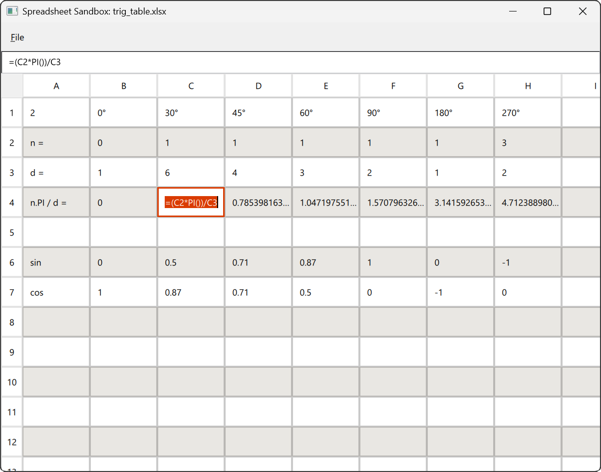
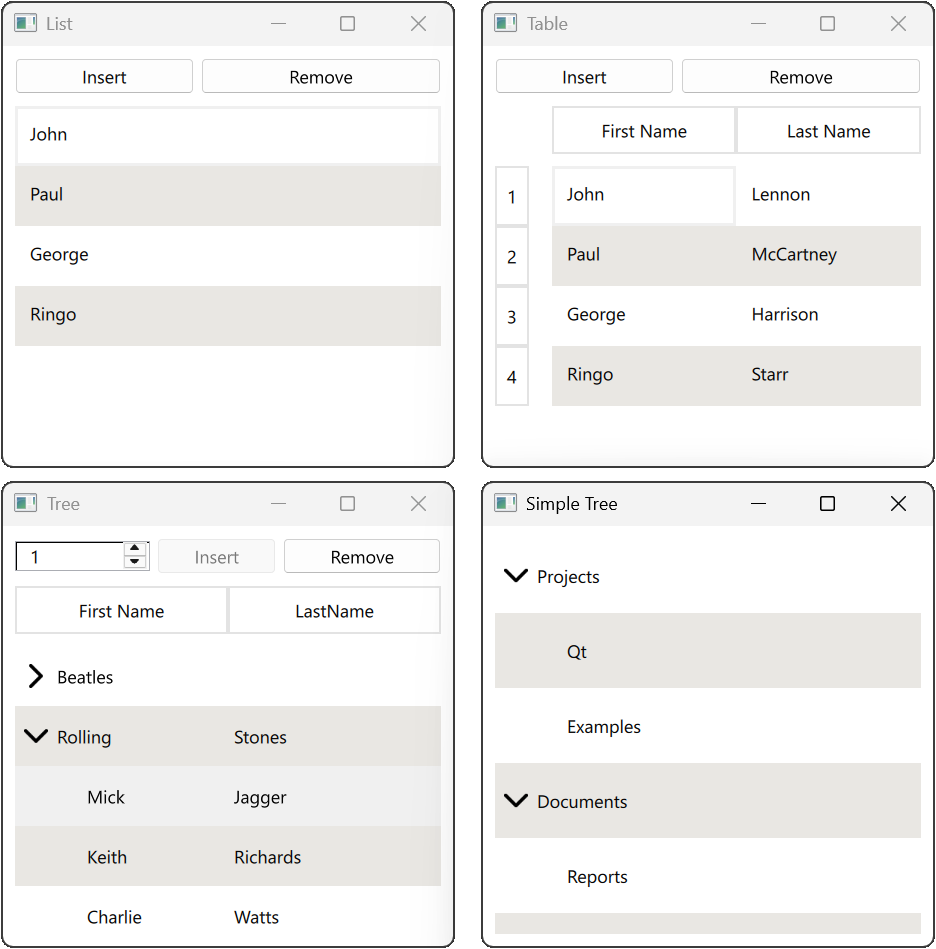
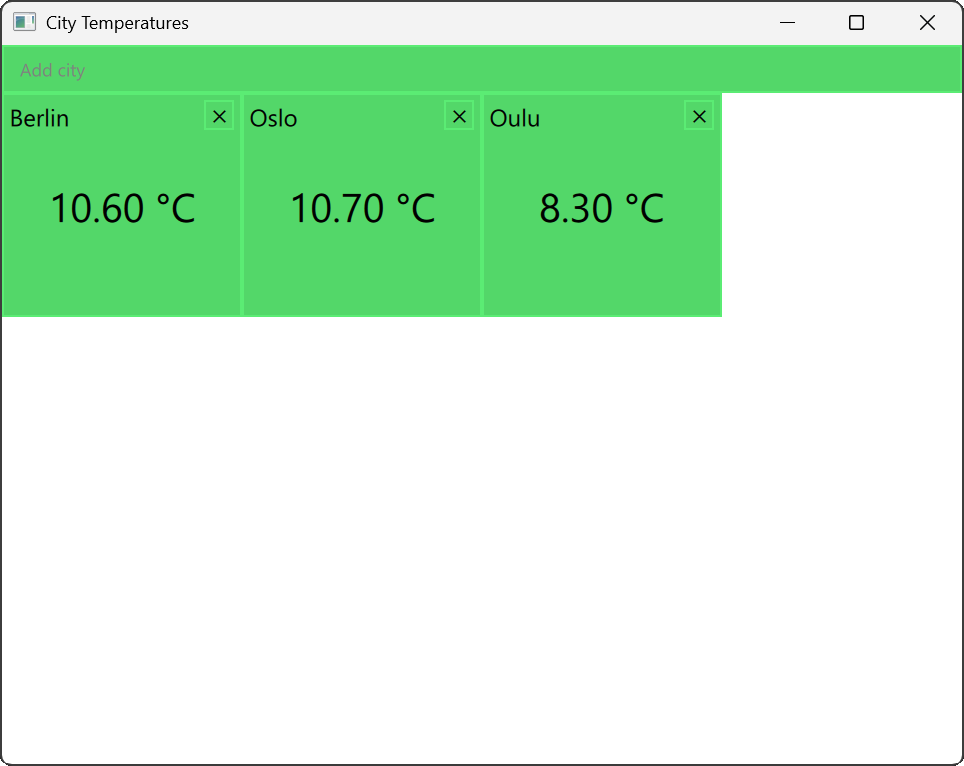
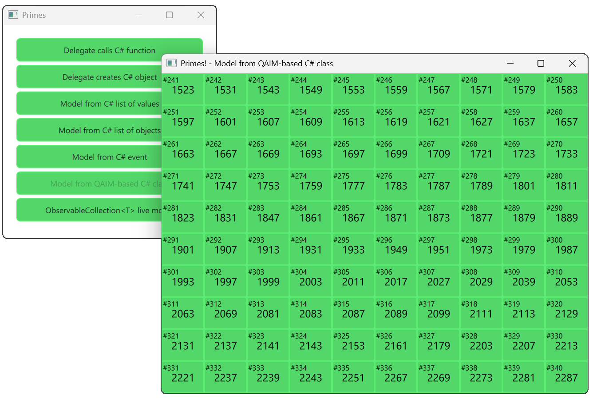

<!--
// Copyright (C) 2026 The Qt Company Ltd.
// SPDX-License-Identifier: LicenseRef-Qt-Commercial OR GFDL-1.3-no-invariants-only
-->

# Qt Bridge for C# &ndash; Examples

## [Weather](Weather)

Weather forecast for the current location.

## [Bookshelf](Bookshelf)

Demonstrates all three Qt Bridge resource access modes (`Native`, `ManagedAndNative` and
`ManagedOnly`) using a book library application that reads cover art, synopsis text, and app
metadata from `.resx` and Qt resources.

## [Spreadsheet Sandbox](SpreadsheetSandbox)

Shows how to build a two-dimensional spreadsheet-like model in C# and expose it to a QML table view.

## [Models and Views](ModelsAndViews)

Shows how to expose C# data to QML `ListView`, `TableView`, and `TreeView` using the corresponding
Qt Bridge model types.

## [City Temperatures](CityTemperatures)

Shows how to model and display tabular data from multiple cities using a C# data class exposed to a
QML view.

## [Primes](Primes)

Demonstrates prime number generation exposed to QML through multiple model patterns: static value
lists, observable collections, item models, and event-driven models.

